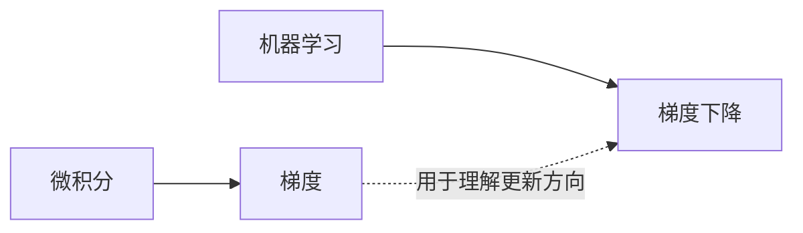

# 第二轮：跨课程关联与学习结构

日期：2026-11-17。状态：设计讨论，候选交互尚未获得用户确认。

## 1. 用户本轮已澄清的内容

- 首个验证方向为阅读教材或课程资料，理解概念、建立联系和自测。
- 学习过程使用电脑输入与手写等混合方式，愿意主动提交关键步骤。
- keeper 的跨分支联系主要指不同学科知识结构之间的联系，包括前置知识及其他有助于理解的关联，希望同时促进复习。
- 用户暂以两棵学习树作比喻，尚不清楚具体如何组织。
- 本轮内容没有取消原先的对话分支需求；对话结构和跨课程知识结构须分别讨论。

## 2. 对首版重点的影响

以理解资料和表达理解为主要场景评审；数学证明检查可以作为其中一种任务，不提前把产品收窄为证明工具。

混合输入意味着系统仅能根据可见材料和用户提交的关键表达做判断。记录应注明来源及缺失证据，避免把不可见的学习过程误当作没有发生。

## 3. 学习树的候选组织方式

建议分开三个对象，具体形式待确认：

| 对象 | 作用 | 不能直接推出的结论 |
|---|---|---|
| 课程目录／大纲 | 按教材或目标组织章节和知识点，提供导航 | 教材顺序不必然是所有人的最佳学习路线 |
| 知识关系网络 | 表达课内及跨课的依赖、应用、类比等关系 | 有关联不等于已掌握，也不意味着必须按该关系学习 |
| 学习记录 | 保存读过、解释过、尝试过和测过的证据 | 看过或记过不等于独立会用 |

候选生成过程：从资料目录提出大纲草稿，在章节中识别具体知识点，允许用户调整；随后提出有依据的跨课关系，把实际学习证据附到对应知识点。大纲草稿与关系候选的生成不构成自动教学质量保证。

课程可以展示为树状目录；跨课程关系需要支持多对多连接。具体数据存储技术暂不决定。

仅作结构示意：

实线表示课程收纳，虚线表示知识之间的具体联系，不表示学习者已经掌握。

## 4. 需要拆开的关系类型

- 前置／用于：当前概念、公式或过程具体用到哪项旧知识。应说明适用范围，避免把一种讲解路线中的前提当成普遍必修条件。
- 共用概念或应用：两个课程在各自语境中使用同一基础概念，需保留语境和来源。
- 类比：两个对象在某些关系上可以对照，需说明对应点及失效边界，不能直接合并成同一概念。
- 一般相关：若不能解释对当前理解有什么帮助，推荐优先级可能很低。

语义相近可以用于提出候选，但不能单靠相似分数确定前置方向或概念等价。

## 5. 新查到的相邻实现

- [Smart Connections 官方仓库](https://github.com/brianpetro/obsidian-smart-connections)：利用本地嵌入推荐与当前内容语义相关的旧笔记和片段，提供列表及图式视图。说明自动关联提醒已有直接先例。其当前仓库声明核心为 source available；本轮没有审查许可证，不据此承诺可直接复用代码。
- [Traverse 官方介绍](https://traverse.link/)：把思维图、关联笔记及间隔复习卡组织在同一产品中。说明知识连接与复习组合已有产品先例；营销表述不作为学习收益证据。

仅凭两棵树连线、知识关联提醒和复习入口，尚不足以主张显著的新颖性。后续需要比较关联质量、出现时机、个体学习证据及实际效果。

## 6. 相关学习研究

[Gentner、Loewenstein 与 Thompson，2003](https://groups.psych.northwestern.edu/gentner/papers/GentnerLoewensteinThompson03.pdf) 在新手学习谈判策略的三项研究中，发现引导对照案例有助于抽取共同结构及迁移；其中一项直接比较了对照两个案例与分别学习相同案例。

对本项目的启发是让关联引发具体的比较或应用，而不止展示一个链接。该研究没有验证 AI 自动跨课程建图、任意学科组合或本项目当前设计。

## 7. 候选交互与角色分工

以下未获用户批准：

1. 用户在阅读当前资料或提交自己的理解。
2. keeper 根据当前需求找出相关旧记录，提出关联类型、依据和此刻的用途。
3. 使用轻量入口提示，保持当前阅读或输入连续。
4. 用户展开后，可以查看原笔记和对照解释；若用户允许，可先尝试一个很短的回忆或比较活动。
5. teacher 根据用户表达提供反馈，必要时帮助补足当前理解所需的内容。
6. 保存这次可见的学习证据，保留是否使用提示及时间，不自动认定永久掌握。

示意关联卡：

> 当前内容：梯度下降。相关旧知识：微积分里的梯度。
>
> 用途：帮助解释更新方向。
>
> 可选回忆：梯度非零时，沿负梯度取足够小的一步，为什么函数值会下降？
>
> 可查看旧笔记、展开对照或暂时跳过。

这是为了讨论交互的例子，不代表已选微积分和机器学习作为首批课程，也不代表要把每条关联都变成测验。

## 8. 本轮提出的问题（已在下一轮获得回应）

1. 主要体验偏向系统按大纲主动导学，还是用户自主阅读、系统辅助？
2. 关联展开后，可否提供可跳过的简短回忆／比较活动，还是仅说明关联？
3. 先选哪两门真实课程及具体章节或资料验证？

后续还需讨论知识节点粒度、资料出处、关系纠错、提示密度、学习目标及成效验证。

下一轮结果：用户选择 teacher 按大纲导学并允许横向探索；关联入口只说明联系和展示旧内容，不采纳上述回忆活动候选；具体验证暂后置。详见 [第三轮记录](design-review-03.md)。
